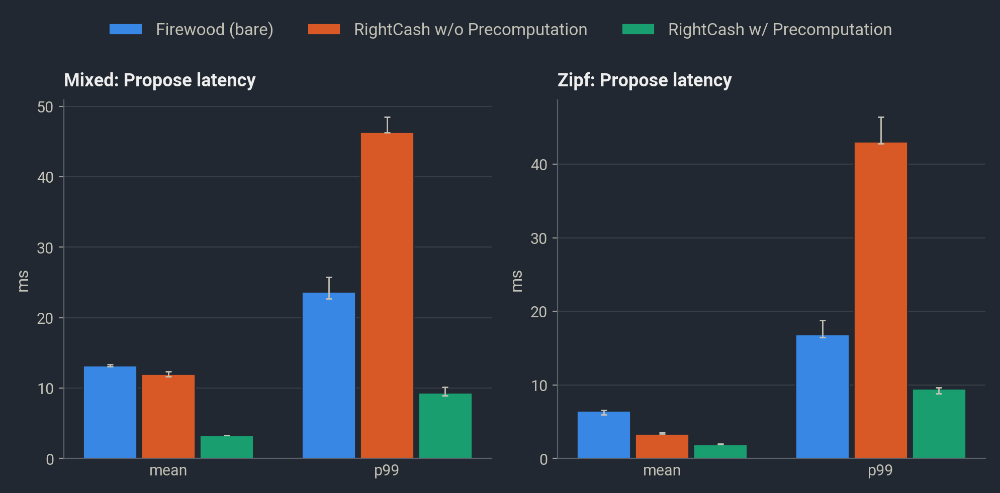
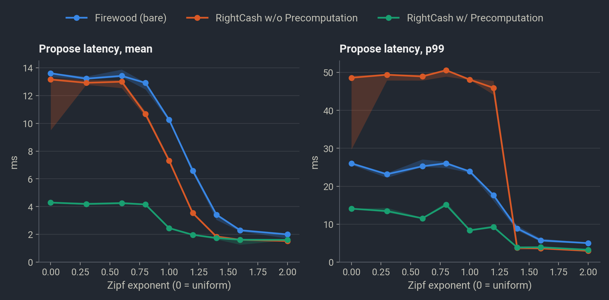
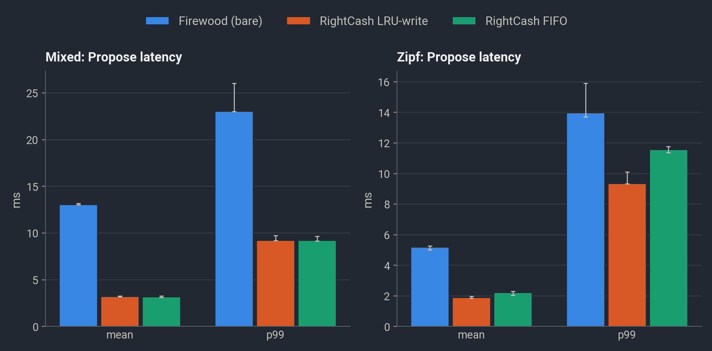
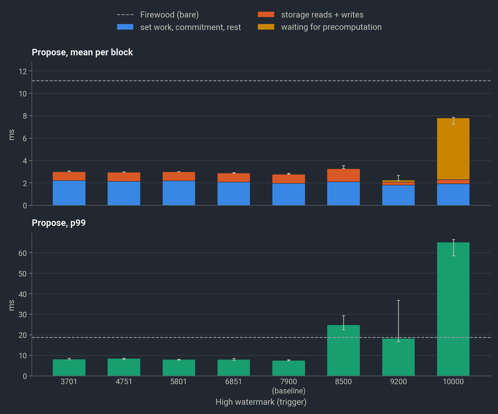
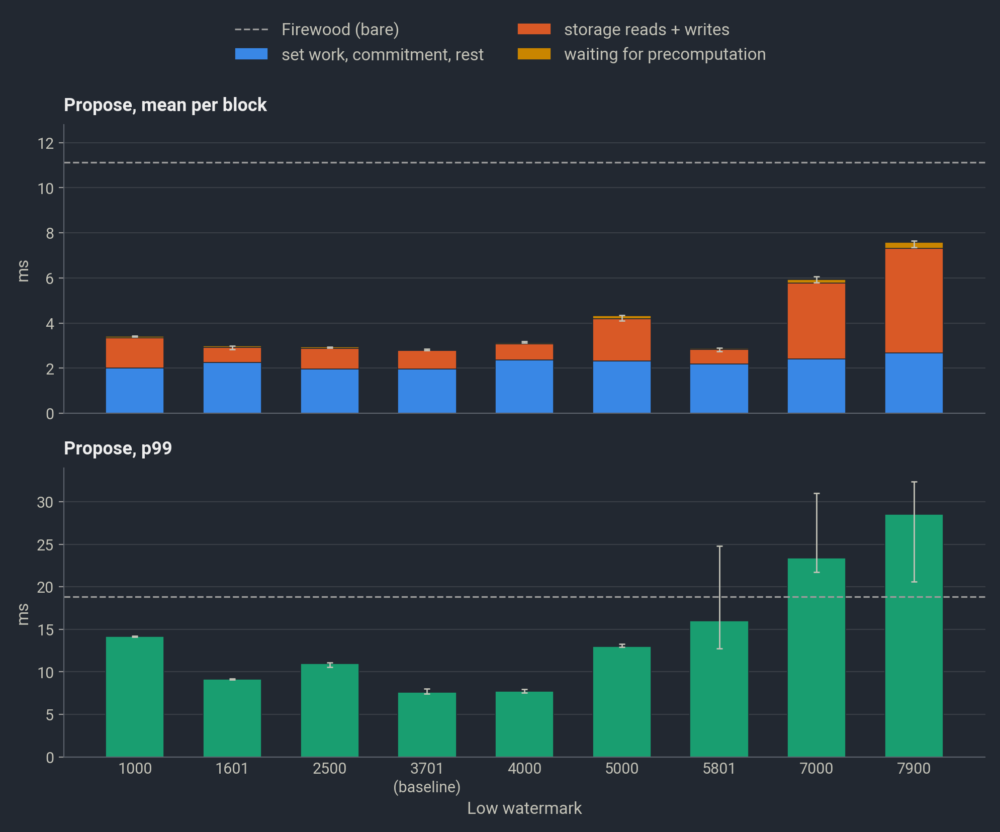
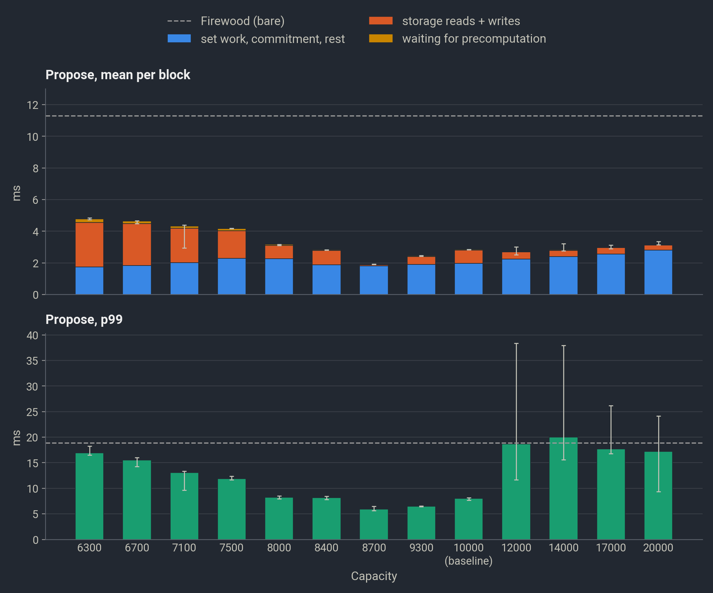
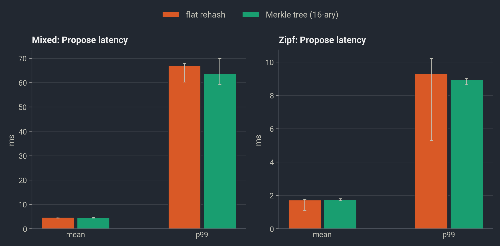

In many blockchain systems, validators store state in a Merkle Patricia Trie (MPT). At the end of every block, the block's writes are applied to the MPT, which computes a Merkle root that commits to all key-value pairs currently in the database. As part of consensus, validators check that they have the same Merkle root to verify that they have reached the same state. With the verified Merkle root, every validator can also generate a proof for each key-value pair in the database, allowing clients to read blockchain state from a single untrusted validator without being fooled. However, computing the Merkle root remains one of the most expensive parts of the current blockchain pipeline. To mitigate this cost, I have spent the past few weeks building [*RightCash*](https://github.com/qusuyan/RightCash), which makes Merkle root computation up to 4x faster, with the help of many different agents (we live in a fancy world!).
<!--more-->

## Merkle Patricia Trie (MPT)

We start by looking at the MPT, the most widely adopted authenticated data structure in blockchains. An MPT stores key-value pairs in a trie (or radix tree). For authentication, every internal node of the trie stores the hashes of its children, and validators verify the hash of the trie root during consensus. Below is a very simplified example. Suppose a write changes the value at key `0x1a8` from `v2` to `v2*`. Then we also need to update `C` so that it stores `8: H(v2*)` instead. Because `C` is updated, `A` needs to change as well, and this effect eventually cascades to the `root`.
```
 root* [ 1: H(A*), 7: H(B) ]
         │         └───────────────┐
      A* [ a: H(C*), c: H(D) ]   B [ ... ]
           │         └─────────────────┐
        C* [ 3: H(v1), 8: H(v2*) ]   D [ ... ]
             │         │
             v1        v2*

 * rehashed when the value at key 0x1a8 changes
```
This design makes it easy to generate two important types of proofs:
- *Inclusion Proofs*: to prove that `0x1a8` stores `v2*`, the validator returns `v2*` to the client along with `C*`, `A*`, and `root*`. The client checks that the hash of `v2*` matches `H(v2*)` stored in `C*`, that the hash of `C*` matches `H(C*)` stored in `A*`, that the hash of `A*` matches `H(A*)` stored in `root*`, and that the hash of `root*` matches the Merkle root verified during consensus. Because the hash function is collision-resistant, the validator cannot feasibly return a different value along with a set of internal nodes that still passes these checks.
- *Exclusion Proofs*: if the client requests the value for `0x1db`, the validator only needs to return `A*` and `root*`. The client verifies `A*` and `root*` against the verified root as above, and sees that `A*` has no entry for `d`, so `0x1db` does not exist in the database.

Performance-wise, however, every storage write requires rewriting and rehashing all of its ancestor nodes. In a production blockchain system, a leaf node may have 10–20 ancestors, and the number grows with the size of the state. At first glance, batching all writes and applying them at the end of the block seems to help, since multiple writes in the batch may share common ancestors. However, because blockchain state is keyed by hashes, writes are often spread across the entire key space, so we still need a lot of cascading writes and rehashes. Even worse, [Nurgle](https://arxiv.org/abs/2406.10687) shows that attackers can intentionally construct a very deep trie that exacerbates the problem.

While the analysis here focuses on MPT, similar problems exist in many other authenticated data structures that order blockchain state by key (e.g., Merkle trees): they support inclusion and exclusion proofs natively, but applying a write batch can be slow.

## Grouping Recent Writes

Some recent storage engines take an alternative approach: instead of always maintaining a sorted data structure, they group recent writes together so that they share common ancestors, significantly reducing the number of disk accesses and rehashes needed at the end of every block. This approach is exemplified by [QMDB](https://arxiv.org/abs/2501.05262) and [COLE](https://www.usenix.org/conference/fast24/presentation/zhang-ce). The problems with this approach are also clear. First, reading state from these data structures is either expensive (COLE is based on LSM trees) or impossible on its own (QMDB builds on an unordered log), so they maintain additional data structures for faster lookups. Second, because writes are grouped by recency instead of being updated in place, the same key can have multiple values, and only the latest one is fresh. However, a validator can generate a valid proof for the stale values as well, which makes inclusion proofs hard. In addition, since keys are not ordered, there is no single place where a given key must live, which makes exclusion proofs non-trivial. Currently, [QMDB](https://github.com/commonwarexyz/monorepo/tree/main/storage/src/qmdb) supports inclusion proofs by additionally maintaining a Merklized bitmap that marks whether each entry is fresh (which kind of defeats the purpose of grouping recent writes), and it supports exclusion proofs by storing the next key in sorted order in each entry.

Another important issue is that adopting a completely new storage engine is very expensive. Production blockchain storage engines typically store hundreds to thousands of gigabytes of data. Migrating all this data to a different storage engine is slow and consumes huge disk space, while keeping both storage engines around is both inefficient and error-prone.

## A Middle Ground?

Given these two kinds of designs, a natural question is: can we get the best of both worlds? Is there a design that supports inclusion and exclusion proofs natively and is still fast at applying write batches? The answer lies in the idea of grouping recent writes itself: if we first group recent writes in a small write cache, and only apply writes evicted from the cache to the MPT, we get a hybrid design where recent writes are grouped together while older writes are ordered by key. If the cache supports both inclusion and exclusion proofs, the combined design supports both proofs trivially:
- *Inclusion Proofs*: if the most recent write is in the cache, the cache's inclusion proof suffices; if the value has been evicted to the MPT, we only need an exclusion proof from the cache and an inclusion proof from the MPT.
- *Exclusion Proofs*: if the key does not exist in storage at all, exclusion proofs from the cache and the MPT suffice to prove its non-existence.

In fact, [SWMT](https://dl.acm.org/doi/10.1145/3786701), published earlier this year, adopts a similar concept. SWMT keeps recent writes in memory and evicts them to the global MPT only when there are too many writes in memory or the writes are old. However, the basic design does not solve the latency of applying the evicted batch to the global MPT. With a full cache, every write that misses the cache causes an eviction that must be applied to the MPT, and applying the evicted writes is not much cheaper than applying the original write set directly to the MPT. SWMT mitigates the problem by moving eviction off the consensus critical path: at the end of a block, the block only includes the state commitment of the cache (the hash that commits to the data, like the Merkle root of an MPT), while the Merkle root of the MPT is verified with the subsequent child block instead. This design comes with a problem: because a block does not commit to the latest MPT root, clients whose trading strategies depend on the current state of the blockchain cannot verifiably read that state from validators. A malicious validator can respond with wrong values to trick them into bad deals. This problem will only grow as trading agents gain wider adoption: users may lose a lot of money before realizing it. So, how do we overcome this problem?

The key observation is that, since the content of the write cache is known, we can easily predict ahead of time which keys will be evicted. This predictability leaves room for precomputation. While executing the transactions in a block, the validator sends the storage engine a `Prefetch` signal for each key it writes. Upon receiving these signals, we can estimate which keys will remain in the cache and which will be evicted. By applying the predicted evictions to the MPT ahead of time, we have the MPT mostly ready even before the validator sends its write batch at the end of the block.

## RightCash

Building on this idea, we developed *RightCash* (bear with me on the bad pun :P). RightCash has the following properties:
- **Native Authentication Support**: it does not require additional mechanisms to support inclusion or exclusion proofs.
- **Fast Propose**: when the validator sends a write batch (a `Propose` request, as many storage engines call it), RightCash computes the updated state commitment quickly.
- **Multi-versioning**: since a proposed block may never be included on chain, RightCash is multi-versioned so that writes in a `Propose` request can be reverted within a time window.
- **Easy Adoption**: since it is a write cache that sits on top of an existing storage engine, blockchain systems can opt in at any time without an expensive migration.

The current implementation persists its state and restarts on a graceful shutdown. Like many other authenticated storage systems, we do not guarantee persistence on failure, and instead expect the validator to recover its state by syncing from other validators.

The architecture looks as follows. RightCash maintains a bounded set of recent writes. A cache eviction policy controls which keys to evict when the cache is full. A vector commitment scheme commits to both the key-value pairs in the cache and the state of the eviction policy. The final commitment returned to the validator combines the commitment to the cached key-value pairs, the commitment to the policy state, and the Merkle root of the storage engine. The commitment to the eviction policy state is necessary because validators need to have the same policy state to make the same eviction decisions.

```
 validator
     │  Propose / Commit / Get / Root / Prefetch
     ▼
 ┌────────────────── RightCash ──────────────────┐
 │  bounded set of recent writes                 │
 │    │    + vector commitment (for proofs)      │
 │    │    + cache eviction policy               │
 │    │           │                              │
 │    │           │ evicted writes /             │
 │    │           │ speculative eviction /       │
 │    │           │ retract speculative eviction │
 │    │           ▼                              │
 │    │        eviction worker                   │
 │    │                │                         │
 │    │ Get (missed)   │ Propose (evicted)       │
 │    │ Commit         │                         │
 └────┼────────────────┼─────────────────────────┘
      ▼                ▼
     Storage Engine (e.g., Firewood)
```

To read a state, RightCash first checks whether the key exists in the write cache. If it does not, the `Get` request is forwarded to the storage engine.

When the validator sends a `Prefetch` signal, RightCash estimates whether the write cache will be full soon. If so, it predicts which keys will likely be evicted based on the cache eviction policy and sends its prediction to the eviction worker, which forwards the speculatively evicted key-value pairs to the storage engine asynchronously. Note that when the cache is full, RightCash evicts multiple entries at once so that eviction is not triggered too frequently. In addition, because the evictions are speculative, we may evict the wrong keys. When the eviction policy notices a wrong speculative eviction, it sends a retract signal to the eviction worker so that it can read and restore the original value.

At the end of the block, when the validator sends a `Propose` request, the cache eviction policy computes the actual set of keys to evict, compares it with the keys it has already evicted speculatively, and sends the difference to the eviction worker for a final refinement of the precomputed state. This time, RightCash waits for the newly computed MPT root from the storage engine, combines it with the commitments to the write cache and the eviction policy state to produce the final state commitment, and returns it to the validator. One important detail is that the eviction policy should make actual eviction decisions based only on the write batches in `Propose` requests rather than on `Prefetch` signals, as these signals may arrive out of order if the validator executes transactions in parallel.

Finally, when the validator sends a `Commit` request, RightCash finds the MPT root associated with the snapshot the validator is committing and sends a `Commit` request for this MPT root to the storage engine. This process does not go through the eviction worker.

### Cache Eviction Policy

For precomputation to work effectively, we should choose a cache eviction policy whose future evictions we can predict correctly. Most cache eviction policies meet this requirement, and we implement FIFO and LRU as a start. FIFO gives 100% prediction accuracy, but an evicted key may be written again in the current block, so we have to recompute the hashes for these keys at the end of the block regardless. However, by then, all their ancestor nodes should already be in memory, so the recomputation does not add much overhead. LRU, on the other hand, ensures that writes in the current block do not get evicted, but it inevitably mispredicts some evictions during precomputation. Therefore, the performance of LRU depends critically on the workload.


#### Capacity, Trigger, and Low Watermark

Some important questions related to the cache eviction design are: how big should the write cache be? When should we start precomputation? And how many entries should we evict at once? RightCash has three important tunable knobs:
- **Capacity** is the size of the write cache. 
- **Trigger** is the number of entries in the write cache at which RightCash starts evicting entries speculatively.
- **Low Watermark** is the number of entries left after an eviction: when the write cache is full, RightCash evicts *Capacity* - *Low Watermark* entries.

The optimal choice of these three knobs depends on the workload, specifically on how many writes a block typically makes and how skewed the writes are. It also depends critically on the cache eviction policy. Ideally, we want the following:
- (*Capacity* - *Trigger*) $\ge$ *writes per block*: so that precomputation starts before the current block, or at least at its beginning.
- *Trigger* $\ge$ *Low Watermark*: otherwise, the trigger would still fire right after an eviction. The exact value of *Low Watermark* presents a trade-off: a smaller *Low Watermark* means more entries are evicted at once, so we accumulate more writes before each eviction and evictions happen less frequently, which leads to a lower average latency; but each eviction also takes longer to precompute, so we might experience a longer tail latency.
- *Trigger* $\ge$ (*Capacity* - *Low Watermark*): when precomputation is triggered, we want to have at least enough entries to evict speculatively.
- *Low Watermark* $\ge$ *writes per block*: the *Low Watermark* should be high enough that writes in the current block do not get evicted to storage immediately, since otherwise there is no way to precompute them upfront. Ideally, it should be high enough that frequently written keys also stay in the cache, so we can make more accurate predictions.

Assuming each write batch has 2100 writes (larger than the average write batch on many blockchains), we choose a *Capacity* of 10,000, a *Trigger* of 7900, and a *Low Watermark* of 3701 for both our FIFO and LRU cache eviction policies. Notice that the ideal conditions above may change with the choice of eviction policy. For example, with a multi-queue eviction policy (e.g., 2Q), the *Low Watermark* should be larger than *writes per block* + the size of the upper queues.


### Vector Commitment

Because the write cache contains only 10,000 entries, it is cheap enough to compute the vector commitment from scratch every time. We implement two vector commitment schemes: a flat hash over the entire set, and a dense Merkle tree. The flat hash simply serializes every key-value pair in the write cache and computes one hash over the result. While simple, the flat hash does not support succinct proofs: the validator needs to give the client the entire write cache for a verifiable read. If the network can tolerate large proofs (e.g., clients rarely request proofs), this flat scheme is both simple and efficient.

The Merkle tree implementation first takes the sorted list of entries in the write cache and computes their hashes. Then, given a branching factor of $b$, it breaks these hashes into chunks of size $b$ and concatenates the hashes in each chunk to form a lowest-level internal node. It then computes the hashes of the lowest-level internal nodes and groups them into chunks of size $b$ again to form their parents, and so on up to the root. With $b=16$, this dense Merkle tree has at most 4 levels. Notably, with careful engineering (thanks to Opus), the Merkle tree performs on par with the flat hash on a set of 10,000 elements.

### Multi-Versioning

Again, because the write cache contains only 10,000 entries, copying the entire set for each proposal is feasible. The cache eviction policy state is part of the write cache and needs to be copied as well, while the vector commitment does not, since we always recompute it from scratch. As a small optimization, the set stores only references to values, to avoid copying large values such as smart contract code.

### Eviction Worker

Many storage engines implement `Propose` synchronously: the calling thread blocks while the engine computes the new Merkle root. To keep precomputation from blocking the validator, RightCash hands it to a dedicated eviction worker through a task queue. During a block, as `Prefetch` signals arrive, RightCash may enqueue a speculative eviction set followed by any number of refinements to it. When the validator calls `Propose`, RightCash enqueues one final refinement. If this `Propose` fills the write cache, RightCash also enqueues a `Finish` request and waits for the worker to return the storage engine's final Merkle root. Otherwise, nothing is evicted in this block, and RightCash computes its commitment from the MPT root at the start of the block, without waiting.

The eviction worker keeps references to two MPT snapshots in the storage engine: a base snapshot that corresponds to the MPT state at the beginning of the current block, and a latest snapshot that changes as the validator processes the current block. Initially, both base and latest refer to the same snapshot. When a speculative eviction is triggered, the eviction worker takes the eviction set from its task queue, turns it into a `Propose` request to the storage engine, and waits for it to complete. Once it finishes, latest is updated to the returned snapshot. If there are refinements in its task queue, the worker merges them into a new `Propose` request on top of the latest snapshot. To avoid sending too many `Propose` requests to the storage engine for repeated refinements, the eviction worker only sends a `Propose` request once it has accumulated enough refinements from RightCash. If the next item in its task queue is a `Finish` request, however, the eviction worker immediately pushes all pending refinements to the storage engine and sends the updated Merkle root back to RightCash when it returns. At this point, it updates the base snapshot to point to the latest snapshot in preparation for the next block (which most likely extends the current block).

One consequence of this design is that if the current block triggers precomputation but does not evict anything at the end, all the precomputed storage engine snapshots are kept for the next block that extends the current block. In the rare case where the next block does not extend the current block, RightCash sends a special `Reset` request to the eviction worker to update its base snapshot reference. In the current prototype, the eviction worker discards its latest snapshot in this case. A better alternative would keep the precomputed snapshot around so that it can be reused if a future block moves back to the original chain.


## Evaluation

We evaluate the effectiveness of RightCash by comparing RightCash on top of Firewood v0.9.0 with bare Firewood. We use two workloads that already exist in the Firewood repository: a Zipfian workload consisting only of updates, each to a key sampled from a Zipfian distribution (with exponent 1.2 by default), and a mixed workload of 25% inserts, 50% updates, and 25% deletes, with keys scattered across the key space. We prefill the storage engine with 1,000,000 records. Then, for each block, we sample 30 groups of 80 writes from the distributions above and send one `Prefetch` signal per group. This imitates a block with 30 transactions, each writing 80 keys. On the mixed workload, about 300 of these 2400 writes hit keys already in the write cache, so only about 2100 new keys enter the cache per block, matching the 2100 writes per block we assumed when choosing the knobs above. We run the experiments in WSL on my personal workstation, with a 20-core Intel i7-12700KF and a Samsung SSD 980 PRO. By default, RightCash uses the LRU eviction policy and the flat hash for its vector commitment, but as we will see soon, RightCash delivers similar performance with FIFO and with the Merkle tree. Here are the results:

<figure class="wp-block-image aligncenter size-full is-resized"><br />
  <figcaption class="wp-element-caption">The performance of RightCash, with and without precomputation, in comparison with Firewood. </figcaption>
</figure>

With and without precomputation, RightCash outperforms Firewood on average on both workloads, showing the effectiveness of caching recent writes so that repeated writes to the same key stay in the cache. However, without precomputation, RightCash barely outperforms Firewood on the mixed workload, where locality is rare. More importantly, because RightCash evicts ~6300 key-value pairs in each eviction, we see an extremely high p99 tail latency without precomputation. Precomputation removes this huge tail, and on average, RightCash with precomputation is 3.26x faster than Firewood on the Zipfian workload and 4.04x faster on the mixed workload.

### Workload Skewness

We run the experiment again with varying Zipfian skewness. The figure below shows the results.

<figure class="wp-block-image aligncenter size-full is-resized"><br />
  <figcaption class="wp-element-caption">The performance of RightCash vs Firewood under the Zipfian workload with varying skewness. </figcaption>
</figure>

Without precomputation, RightCash's mean latency is close to Firewood's when the workload is nearly uniform (exponents up to 0.6), and its p99 tail latency is about twice Firewood's or worse at every exponent up to 1.2. From an exponent of 0.8 upward, its mean latency beats Firewood's, but its tail only drops below Firewood's from 1.4, where so few blocks trigger an eviction (1% or fewer) that the p99 no longer sees them. In clear contrast, RightCash with precomputation beats Firewood in both mean and p99 tail latency at every exponent: it is roughly 3–4x faster on average up to an exponent of 1.2, and its p99 is 1.5–2.9x lower throughout. The gap narrows at 1.6 and above, where the high locality leads to small `Propose` batches that all three handle well.

### LRU vs FIFO

The figure below shows the performance of RightCash with precomputation, using LRU vs FIFO eviction policies. Overall, both policies deliver very similar performance. On the Zipfian workload, LRU slightly outperform FIFO because FIFO would evict even the hottest keys. And when it does, if these hot keys are written in the current block, RightCash need to include in its final refinement the key with the updated value. And in the next iteration, the hot key is likely to enter the write cache again, causing more evictions. The impact, however, is small. RightCash with FIFO only experiences a 17% higher average latency and 23.9% higher tail latency. 

<figure class="wp-block-image aligncenter size-full is-resized"><br />
  <figcaption class="wp-element-caption">The performance of RightCash, with FIFO vs LRU cache eviction policies. </figcaption>
</figure>

### Choosing *Capacity*, *Trigger*, and *Low Watermark*

In this experiment, we vary *Capacity*, *Trigger*, and *Low Watermark* to see their impact. We use LRU for cache eviction and evaluate on the mixed workload.

We start with *Trigger*. From the figure below, we see that the exact value of *Trigger* has minimal impact on `Propose` latency as long as it is at most 7900. With larger values, precomputation may start too late, and we see a significantly increased tail latency.

<figure class="wp-block-image aligncenter size-full is-resized"><br />
  <figcaption class="wp-element-caption">RightCash with varying <i>Trigger</i>.</figcaption>
</figure>

Next, we move on to *Low Watermark*. With a large *Low Watermark*, precomputation is triggered repeatedly, causing excessive interaction with the storage engine; but with a small *Low Watermark*, RightCash makes more mistakes in its precomputation, which also leads to more reads and writes to the storage engine and a much higher tail latency.

<figure class="wp-block-image aligncenter size-full is-resized"><br />
  <figcaption class="wp-element-caption">RightCash with varying <i>Low Watermark</i>. </figcaption>
</figure>

Finally, we vary *Capacity*, fixing *Trigger* at *Capacity* - 2100 and *Low Watermark* at *Capacity* - 6299. With a small capacity, the small *Low Watermark* degrades performance. But as capacity grows, so does the time spent managing the write cache, including maintaining the eviction policy and computing the vector commitment. The cause of the high tail latency with *Capacity* $\ge$ 12,000 remains a mystery at this point. We suspect that the persist path inside Firewood causes this unusual behavior, since it also shows a strong correlation with the tail latency observed in other experiments as well. 

<figure class="wp-block-image aligncenter size-full is-resized"><br />
  <figcaption class="wp-element-caption">RightCash with varying <i>Capacity</i>. </figcaption>
</figure>

### Flat Hash vs Merkle Tree

The figure below shows the performance of RightCash with precomputation, using the flat hash vs the Merkle tree for vector commitment. The two commitment schemes deliver almost identical performance on both workloads. At the scale of 10,000 entries, most of the time goes into hashing each individual entries, while the cost of combining these entries together is almost negligible in both commitment schemes. 

<figure class="wp-block-image aligncenter size-full is-resized"><br />
  <figcaption class="wp-element-caption">The performance of RightCash, with flat hash vs Merkle tree for vector commitment. </figcaption>
</figure>


## What's Next

RightCash delivers fantastic performance, but there is still room for improvement. First and most importantly, for each eviction, RightCash submits one `Propose` for the speculative eviction set and multiple follow-up `Propose` requests for refinements. This creates numerous intermediate snapshots that we only need temporarily. Firewood, as the underlying storage engine, keeps these intermediate snapshots around, which degrades performance. Achieving the best performance requires a different interface, through which we can tell the storage engine that a given `Propose` is just a prediction that we may refine later. Relatedly, since the root (and potentially other nodes near the top of the trie) is recomputed on almost every `Propose`, it makes intuitive sense to defer computing them until the end of the block.

Another interesting question is: can we design a cache eviction policy that evicts entries with longer shared key prefixes together? In MPT, keys with longer common prefixes share more common ancestors, so evicting them together reduces the number of hash computations in the storage engine. This not only reduces eviction latency, but also reduces CPU utilization and disk footprint, saving these resources for other foreground tasks like transaction execution and signature verification.

Last but not least, SWMT explores an algorithmic way to adjust *Capacity*. Can we do the same with *Trigger* and *Low Watermark* to deliver better performance? These three knobs have a profound impact on one another and depend heavily on the cache eviction policy and the workload, making it challenging for the network to choose them upfront. An algorithm that adjusts the three knobs based on the current workload and RightCash's behavior could not only improve overall performance, but also open up a wider choice of cache eviction policies.

## Agent Experience

We are currently in an era where every technical blog post needs to mention agents somehow, so here is my take:

I started the project with Fable 5.1. Step by step, it generated a complete design for RightCash, adapted Firewood's benchmarks, laid out the skeleton code, implemented RightCash (first without precomputation, then with it), developed many test cases, and evolved the initial design along the way. Fable can work independently for hours and deliver a correct but tedious codebase, full of unnecessary designs and repetitive logic that both obscure the code and limit performance. A human in the loop is needed, but waiting hours for each round makes the process extremely unpleasant.

When I ran out of Fable credits, I moved to GPT-6 Astra out of frustration. Astra is great when we need a human in the loop, since it usually finishes within minutes and gives a decent result, but it is often overly conservative, especially on an already obscure codebase. It took me hours of talking with Astra before we agreed that some of Fable's design was completely redundant and Astra was willing to remove it.

Towards the end of the project, I decided to try Opus 5.5 because why not. My task for it was simple and straightforward: implement the Merkle tree vector commitment and optimize its performance as much as possible. It did the job excellently for the most part. The only thing I did not like: the Merkle tree needs to update its internal state, which the vector commitment interface did not allow because it takes an immutable `&self`. Instead of changing the interface, Opus created a new struct just to hold that state and added it to the function signature so that `&self` could stay in place — a very conservative but totally unnecessary move, since `&self` was a mistake I had not caught; it should have been `&mut self` in the first place.

So what did I learn in the process? First, frontier agents seem to favor conservative code changes that touch only a small part of the project. This is indeed a good move in many cases, especially when dealing with a large codebase that is hard to comprehend. With a conservative change, the agent only needs to read and understand the code it touches, while the rest of the code keeps its original behavior, so we do not need to worry about its correctness. However, in many cases, a conservative change only scratches the surface of the bigger problem we are actually trying to solve. These "small patches" can easily obscure the intention of the code, making it hard to read or understand later. One may argue that only agents will read the code anyway, so readability does not matter, but an obscure design can lead to suboptimal performance and make the codebase more error-prone. So the common practice of giving agents feedback only through tests and benchmark suites is insufficient; we also need a way to give them feedback on the clarity of the code, so that they can develop good engineering taste.

Second, design flaws accumulate over time. When an agent makes a bad design choice and we do not correct it promptly, the bad design shapes the code that this agent, or other agents, write afterward. In RightCash, Fable made a mistake in handling the final refinement when the write cache is full at the end of the block. Instead of sending the refinement to the eviction worker and waiting for the Merkle root, Fable decided to fetch the Merkle root from the eviction worker first, then submit the refinement set to the storage engine itself as a separate `Propose` request. This seemingly correct approach means that, if the eviction worker has buffered refinements, the validator first blocks while the eviction worker calls `Propose` on the storage engine, then blocks again on a second `Propose` for the last refinement, putting two `Propose` requests to the storage engine on the critical path. Because of this design, RightCash handles the final refinement differently depending on whether the write cache is full at the end of the block. Correspondingly, Fable had RightCash return two refinements, one used only when there is no eviction and one used only when eviction actually happens. When I asked Astra why we needed two refinements, Astra was convinced that this was the correct and efficient design. It took me a long time to really understand this part of the code and to convince Astra that the design was redundant. Obviously, in an ideal world, agents would develop good enough taste to know the right way to handle the last refinement. But until we figure out how to give agents feedback on the clarity of the code, it is crucial to correct their bad decisions as soon as possible, before they lead to even more bad decisions.

Third, agents are incredibly good at small tasks with a lot of details, as Opus showed by writing a Merkle tree vector commitment that performs slightly better than the flat hash. We should certainly leverage this by breaking a large design into small, standalone pieces that we can hand to agents freely. Our focus should stay on how to break the system into smaller pieces and how those pieces should interact with each other.

This is certainly not to suggest that agents are not the greatest invention of the 2020s — without them, it would have been impossible for me to write even an unoptimized version of RightCash in just one or two weeks. Maybe I am just not using agents correctly to unleash their full potential, but it is a relief to see that I still have a place in guiding agents through the development of RightCash. Given how fast this field has been evolving, we will probably see agents with good engineering taste in a matter of months, and none of the takeaways above will matter anymore. But for now, humanity wins this round :).
